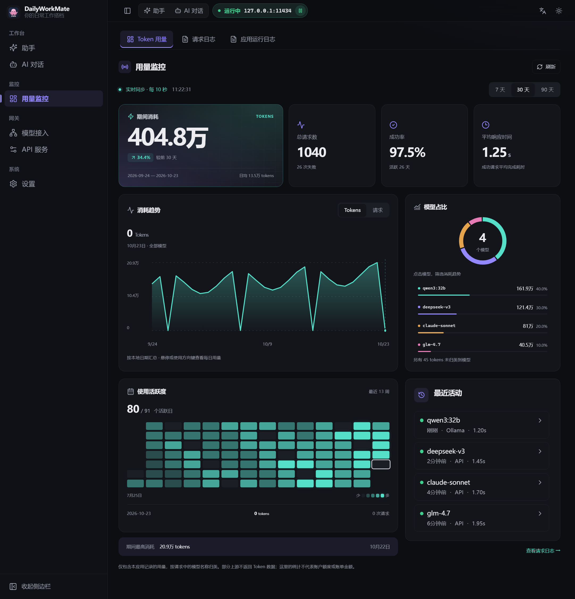

<h1 align="center">DailyWorkMate</h1>

Your AI assistant, workspaces, terminals and model connections in one desktop app.

<a href="README_CN.md">简体中文</a> · English · <a href="docs/installation.md">Installation guide</a> · <a href="LICENSE">GPL-3.0</a>

DailyWorkMate connects daily planning with actual work. Discuss a task, organize your todos, let an agent work in authorized folders, run commands in a terminal, and manage models and usage from the same window. Connect your API providers, Ollama nodes, or the free model gateways offered by OpenCode and Kilo.

## At a glance

The sidebar groups related features into six destinations, with their settings organized inside each section.

| Destination | What you can do |
| --- | --- |
| **Assistant** | Chat, plan, manage Daily Todo, configure voice and character; switch to Work or Terminal. |
| **AI Chat** | Use a separate chat interface with task prompts, translation targets, attachments and conversation history. |
| **Usage monitor** | Explore token usage, trends and model distribution; inspect request and application logs. |
| **Model connections** | Manage providers and accounts, Ollama nodes, model lists and mappings. |
| **API service** | Configure listeners, local API keys, load balancing, sessions, context and advanced options. |
| **Settings** | Adjust theme, language, fonts and display preferences, and view application information. |

## Assistant and Daily Todo

- **Chat and plan:** streaming replies, conversation history and model selection, with an editable assistant name and persona.
- **Todo notes:** a paper-style Markdown note can appear when you mention DailyTodo, Daily or Todo, or when a related document is found in an authorized workspace. Notes support headings, nested checklists, tables, quotes and code.
- **Manage tasks directly:** add, edit and delete tasks with confirmation; switch between To do, Doing and Done. Edits preserve task details and subtasks, and saving checks for external file changes. Personal notes stay local; workspace notes follow folder permissions.
- **Carry plans forward:** **Copy latest** duplicates the complete note. **Copy unfinished** carries over open tasks and unfinished subtasks. Copies use today's date and leave the original intact.
- **Voice and character:** microphone input, an optional spoken-reply switch, full or summarized reading, system voices, optional local speech and compatible speech APIs. Choose the included octopus, a custom image or a supported GLB/GLTF avatar.
- **Move from discussion to action:** with a workspace connected and a tool-capable model, hand file tasks to a workspace agent.

## Workspaces: agents working in authorized folders

Drop folders into the app or choose **Add folder**, then grant read-only or editable access. Group related directories together, or narrow a task to a subfolder.

- **Native agent sessions:** use OpenCode or a locally installed Claude Code CLI. Each Work tab has its own folder or group, with its model, engine and access scope visible.
- **Parallel tasks:** keep several Work sessions open while switching to chat or other pages.
- **Files and task progress:** browse authorized text files, attach their contents, follow responses, tools, errors and permission requests, and stop tasks when needed.
- **History and recovery:** reopen conversations from Recent sessions. If a display disconnects, reattach to its still-running service. Once the service stops, an explicit restart can restore conversation history; it does not automatically resume the old process.
- **Permission changes:** affected tasks stop until explicitly started again with new permissions; unrelated folder sessions keep running.
- **Focus mode:** work fullscreen with session tabs and controls available. Fold away the title and keep model selection, tips and terminal options in one row.

Folder rules constrain agent tools. Shell commands run with your operating-system account's permissions; modes that cannot reliably constrain commands to a narrower scope disable them.

## Terminal: keep your working layout close at hand

The terminal uses a real PTY. On Windows, it supports **PowerShell, CMD and installed WSL distributions**.

- **Tabs and split panes:** use up to four independent shells per tab and drag dividers to resize them.
- **Restore directories and layouts:** save unclosed tabs, panes, shell types and working directories. Restarting the app starts fresh shells as needed; switching pages while the app runs keeps existing processes alive.
- **Visible activity:** running tasks show an animated indicator, completed tasks show a check, and idle terminals show a quiet ring. Work and Terminal indicators remain visible from chat.
- **Directory shortcuts:** drop a folder to open a terminal there. The footer follows `cd` changes and opens the current directory in your file manager.
- **Output controls:** selection copying, adjustable scrollback, display redraw and fullscreen focus mode.
- **Controlled shutdown:** quitting waits for ordinary terminal and work processes to stop. Detected psmux sessions can be closed or retained, or quitting can be cancelled. Minimizing to the tray keeps the app running.

| Action | Shortcut |
| --- | --- |
| Copy a terminal selection | Ctrl+C / ⌘C, Ctrl+Shift+C or right-click. Without a selection, Ctrl+C interrupts the command. |
| Select or scroll when a program captures the mouse | Hold Shift while dragging or scrolling. |
| Split right / down | Alt+Shift+= / Alt+Shift+-. |
| Switch panes | Alt+Arrow. |
| Enter / leave focus mode | F11. Esc inside a terminal continues to reach the running program. |

## Usage monitor: trends, model distribution and request performance

- **7, 30 and 90-day views:** inspect recorded tokens, requests, failures, success rate and average completion time.
- **Usage trends:** switch between tokens and requests, inspect dates with the pointer or keyboard, and select a model to filter the chart. Summary cards continue to show all models.
- **Model distribution:** compare token and request counts, with an expandable model list.
- **13-week activity heatmap:** explore active dates, daily usage and the period's peak.
- **History coverage:** retain at least 180 days of usage history. Data removed by earlier versions is marked unavailable; incomplete history disables period comparisons instead of treating missing days as zero.
- **Linked logs:** open a recent request's details and switch between request and application logs. The visible monitor refreshes every ten seconds and supports manual refresh.

The monitor covers usage recorded by this app. Some native direct connections, internal summaries and upstream responses without token data are not fully included. Provider balances and bills remain authoritative for quotas and charges.

## Model connections and global routing

| Source | Features |
| --- | --- |
| **Providers and APIs** | Built-in channels, API-key presets, custom compatible endpoints, multiple accounts and model mappings. |
| **Ollama** | Local or LAN nodes, scanning and bulk import, authentication, model refresh and connection checks. |
| **OpenCode free models** | A dynamic free catalog and capability information, with supported connections for chat, workspaces or the compatibility proxy. |
| **Kilo free models** | Models from the upstream free catalog without a personal API key; workspace use requires tool support. |

**Model connections → Ollama Nodes → Global Model Routing** offers two behaviors:

- **Force selected model:** route applicable API requests to a chosen Ollama or supported free model target.
- **Route the original request model:** select an available node using the model name requested by the client.

Both options are available in the same configuration; forcing a model takes precedence when enabled. A routing test button checks the configuration. An unavailable saved target stays selected and reports an error. Explicit model selections in desktop chats are preserved.

Free catalogs, availability and quotas are controlled upstream; a listed model does not guarantee available free inference. Image, reasoning, search and tool capabilities depend on the provider and model. See the [provider reference](docs/providers/README.md) and [free model connections](docs/free-models.md).

## API service: share your model setup with other clients

- **Compatible interfaces:** OpenAI Chat Completions, Anthropic Messages, and Ollama model-list and chat endpoints.
- **Shared connections:** reuse configured providers, Ollama nodes and supported free models from other clients.
- **Service controls:** manage listen addresses and ports, local API keys, load balancing, retries, timeouts and model mappings.
- **Context and tool adaptation:** configure tool behavior for provider capabilities and manage context with sliding windows, token limits or summaries.

## Appearance and preferences

Choose English or Chinese, light or dark themes, font settings, a collapsed or hidden sidebar, and GPU compositing preferences that apply after restart. Switch between Assistant, Work and Terminal as the task changes, with layouts that adapt to smaller windows.

Screenshots show the actual app with fictional conversations, directories and usage data. The terminal capture uses local PowerShell. Desktop validation currently focuses on Windows.

## Installation and further reading

The [installation guide](docs/installation.md) covers distribution packages, source setup, builds, optional OpenCode and speech resources, data locations and upgrades.

[Speech guide](docs/speech.md) · [Provider reference](docs/providers/README.md) · [Free model connections](docs/free-models.md)

## License and acknowledgements

GPL-3.0. See [LICENSE](LICENSE) and [NOTICE](NOTICE). Electron, OpenCode, Claude Code and optional speech components have their own licenses and requirements.
