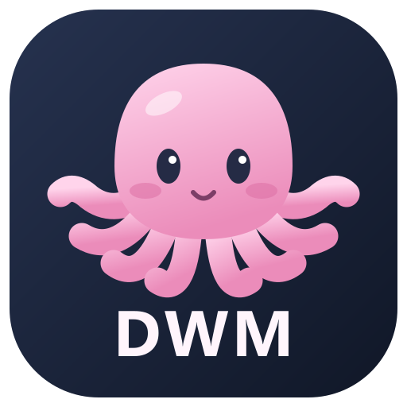
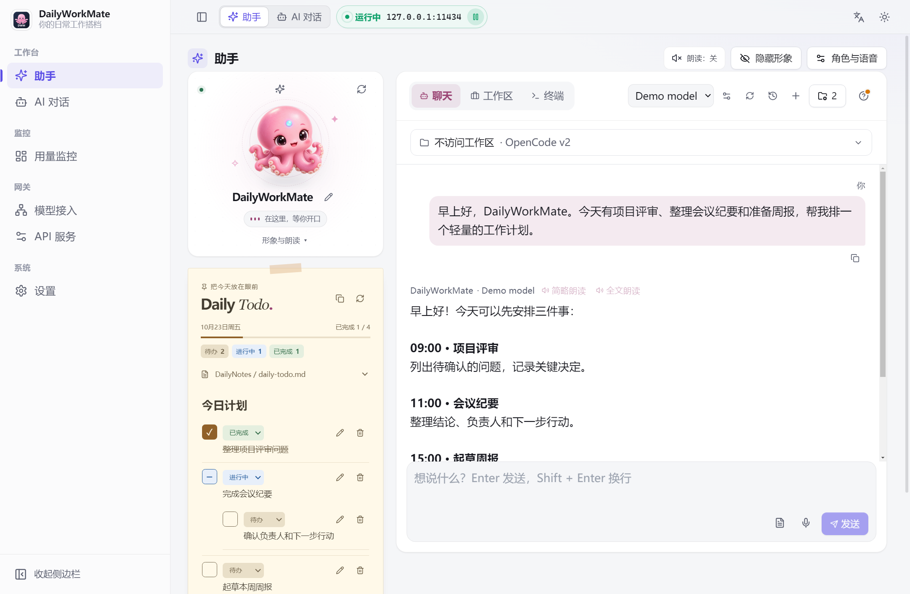
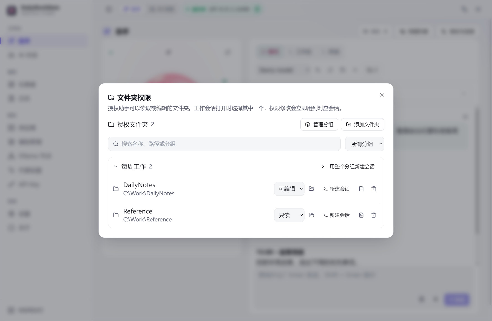
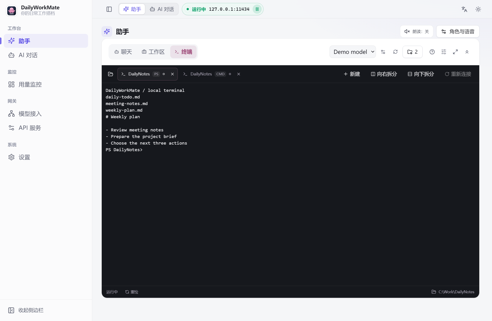

<p align="center"></p>

<h1 align="center">DailyWorkMate</h1>
<p align="center">An AI assistant, your workspaces, and a terminal — together on your desktop.</p>
<p align="center"><a href="README_CN.md">简体中文</a> · English · <a href="https://github.com/SecondBrainSystem/DailyWorkMate">GitHub</a> · <a href="LICENSE">GPL-3.0</a></p>

DailyWorkMate is a desktop companion for everyday work. Talk through a plan, let an AI agent work with folders you authorize, and keep your terminal sessions close at hand. Connect your AI providers or Ollama models and choose the model and working mode for each task.

## Highlights

- **Free models, self-hosted or hosted:** add a local or LAN Ollama node to run open models with no API fees, or use OpenCode's free models directly (the free catalog and quotas are provided by OpenCode and may change).
- **Pick up where you left off:** terminal tabs, split panes, shell types and working directories are saved automatically and restored the next time you start the app — no need to reopen terminals and `cd` back after a reboot.
- **Workspace history:** authorized folders, folder groups and recent Work sessions are kept, so you can reopen a session and continue.
- **AI that works in your folders:** run OpenCode or Claude Code against folders you authorize, with model, engine and access scope always visible.
- **One window:** chat and planning, workspace agents and a real terminal in a single desktop app, plus a local OpenAI-compatible proxy for other clients.

## Assistant



- **Chat and plan:** streaming replies, conversation history, model selection, and an editable assistant name and persona. The default name is **DailyWorkMate**; use the pencil beside it or **Character & voice → Assistant name** to save your own.
- **Daily Todo note:** mentioning DailyTodo, Daily or Todo in chat, or finding a related folder/document in an authorized workspace, reveals a paper-style note below a smaller avatar. Markdown renders headings, nested checklists, tables, quotes and code. In writable workspaces, checking a task saves its marker directly to the file; external edits are detected before saving. **Copy for today** copies the latest version in the same folder and name series to a file dated `YYYY-MM-DD`, adds a number if needed, and opens the new copy. Originals and checkmarks are preserved. Read-only folders remain read only; personal notes support editing, checkboxes and local persistence.
- **Copy content:** messages and notes have copy buttons. Select text in messages, headings or interface descriptions and copy it with the keyboard or the context menu.
- **From conversation to action:** chat-only mode can hand file tasks to a workspace agent when a workspace is connected and the model supports the handoff tool.
- **Voice:** microphone input, optional spoken replies, full or summarized reading, and voice settings. Local recognition and synthesis require the optional speech resources; system voices and compatible speech APIs are also supported.
- **Your companion:** the included octopus, a custom image, or a supported GLB/GLTF avatar with a 3D viewer.

## Workspaces



Drag one or more local folders from your file manager into Work (or use **Add folder**). In the confirmation panel, choose an existing group or create one, and set **read only** or **can edit** access. Each Work tab is a separate agent session bound to a folder or group, with its model, engine and scope visible. Recent sessions can be reopened.

| Feature | Purpose |
| --- | --- |
| Open folder | Use the folder icon on the Work tab bar or beside an authorized folder to open its directory in your system file manager. |
| File browser | Browse authorized text files and attach their contents to a conversation. |
| Folder groups | Work across related folders, or narrow a task to one subfolder. |
| OpenCode | Use a native OpenCode v2 session inside the app; install the optional runtime with the setup script. |
| Claude Code | Use a locally installed Claude Code CLI through the configured model proxy. |
| Task visibility | Follow responses, tools, errors and permission requests; stop tasks or change models. |
| Focus mode | Select **Focus mode** in the upper right to make Work fullscreen while keeping session tabs. Select **Exit focus** or press F11 to return; Esc also exits when the focus is outside a terminal. |
| One control row | Tabs, model picker, tips (**?**) and terminal options share a single row above the sessions; tips and options open as small panels instead of taking rows. The double-chevron button at the end of the row also folds the page title away in Work and Terminal (remembered; Chat always shows it). |

Shell commands run with your operating-system account's permissions. Folder rules constrain agent tools; they are not an OS sandbox. Read-only and subfolder scopes disable commands where the engine cannot enforce a narrower boundary.

## Terminal



The **Terminal** tab is a real PTY terminal with xterm.js. On Windows it supports **PowerShell, CMD and installed WSL distributions**. Choosing OpenCode opens a folder-bound Work session.

Copy terminal selections with **Ctrl+C / ⌘C, Ctrl+Shift+C or right-click**. Without a selection, Ctrl+C still interrupts the command. Hold **Shift while dragging** to select text when a program captures the mouse. Work terminals use the same shortcuts.

- Keep multiple terminal tabs open and switch views without restarting their processes. Each tab shows what its terminal is doing: a pulsing dot while a command runs or an agent such as Claude Code, Codex or OpenCode works on a turn, a green check once it has finished (until you type in that terminal), and a quiet ring when idle. Simply having Claude Code, Codex or OpenCode open, or a command that finishes within two seconds, does not light up; only an actual turn or a longer command does. The Work and Terminal tabs above show the same marks, so you can see a finished run from the chat view.
- Split a tab into up to four panes to run a script in one while working in another: **Split right** (Alt+Shift+=) or **Split down** (Alt+Shift+-). Alt+Arrow moves between panes. Drag a divider, or focus it and use the arrow keys, to resize. Each pane is its own shell, starts in the focused pane's folder, and has its own close button. Narrow windows stack side-by-side panes vertically.
- Select **Focus mode** in the upper right (or press F11) for a fullscreen terminal. **Exit focus** or F11 restores the layout while the same processes and sessions continue running. Inside a terminal, Esc goes to the shell or TUI (for example Claude Code or vim) instead of leaving fullscreen. Switch between Work and Terminal in fullscreen; returning to Chat exits focus mode.
- Drop a folder to choose **Open a terminal here** or **Add to authorized workspaces**.
- Click the folder icon or path in the footer to open the current directory; it follows `cd` changes. Use normal shell history, copy output, and resize the terminal.
- Scroll back with the mouse wheel. Programs such as Claude Code, Codex or vim may take over the mouse; hold Shift while scrolling to view the terminal's own history instead. **Terminal options → History lines** keeps 10,000 lines by default (1,000–50,000).
- If a long-running program's display drifts (for example its input box is no longer visible while typing still works), select **Redraw** in the pane's status bar to repaint it.
- Restore unclosed tabs and directories at startup, with a clean screen for each new shell.
- Quitting waits for ordinary terminals and work processes to stop. If psmux sessions are detected, choose to close them, retain them, or cancel quitting. Minimizing to the tray keeps the app open.

Screenshots show the real application with fictional demonstration data. The terminal capture uses a real local PowerShell process. No personal accounts or conversations are included.

## Models and integrations

DailyWorkMate includes provider/account management, official API-key presets, Ollama nodes, model mappings, request logs and a local OpenAI-compatible proxy. The separate AI Chat page supports task prompts and translation target languages. OpenCode's free-model catalog is provided dynamically; availability and quotas may change. Catalog errors do not indicate exhausted quota. Catalog status, free-model guidance and folder-drop help open from the **?** button in the control row; a dot on it marks a catalog problem or a free-model limitation.

Configure a provider or Ollama node first, then select a model in the assistant. Image, reasoning and tool support depend on the selected provider/model. Speech endpoints are separate from chat endpoints.

See the [provider reference](docs/providers/README.md) for built-in model defaults and provider-specific limitations.

## Run on Windows

**Prefer the folder distribution for everyday use.** Keep the entire folder and run `DailyWorkMate.exe`; its DLLs and `resources/` must stay alongside it. Unlike a single-file portable EXE, this starts without unpacking the application on every launch.

Build from source:

```powershell
git clone https://github.com/SecondBrainSystem/DailyWorkMate.git
cd DailyWorkMate
npm ci
npm run build:folder
```

Output: `dist/DailyWorkMate-folder/win-unpacked/DailyWorkMate.exe`. Optional runtimes are bundled only when set up for the target platform before packaging.

## Development

Requires **Node.js 22.18+**, npm and Git. Native dependencies may require platform build tools if compatible prebuilt binaries are unavailable.

```bash
npm ci
npm run dev:win       # Windows
npm run dev           # macOS / Linux
npm run typecheck
npm test
npm run build
```

| Command | Purpose |
| --- | --- |
| `npm run build:folder` | Windows x64 folder distribution, without per-launch extraction. |
| `npm run build:win` | Windows installer and self-extracting portable EXE. |
| `npm run build:mac` / `npm run build:linux` | Other platform packages. |
| `npm run companion:setup` | Download the supported OpenCode runtime. |
| `npm run companion:speech:setup` | Install optional [local speech resources](docs/speech.md). |
| `npm run icons` | Generate PNG/ICO assets from the [editable SVG](build/brand.svg). |

Windows is the currently exercised desktop target. macOS/Linux build configurations exist, but shell choices and bundled runtimes depend on the platform; Windows feature validation does not imply validation elsewhere.

## Data and upgrades

- Configuration and accounts: `~/.dailyworkmate/`.
- UI preferences and conversation databases: Electron's `dailyworkmate` user-data directory.
- Folder-distribution companion data: `companion/` next to the EXE. Installer builds use user data; development uses the project's `companion/` directory.
- Set `DAILYWORKMATE_COMPANION_HOME` to reuse an existing companion directory, such as the `companion` folder beside a previous portable EXE.
- Upgrades import old settings and history while preserving the originals. Legacy encryption identifiers and environment aliases remain for compatibility.

Downloaded runtimes, models, personal data and internal planning records are excluded from Git. Requests go to the providers you select; a desktop client does not make a remote model local.

## Source layout

`src/main/` contains Electron services, agents, terminals and the proxy; `src/preload/` exposes IPC; `src/renderer/` holds the React interface; `src/shared/` defines shared contracts. `scripts/` contains builds and checks, `tests/` holds regression coverage, and `build/` contains branding assets.

## License

GPL-3.0. See [LICENSE](LICENSE) and [NOTICE](NOTICE) for attribution. Electron, OpenCode, Claude Code and optional speech components are separate projects with their own licenses and requirements; runtime setup preserves their notices.
